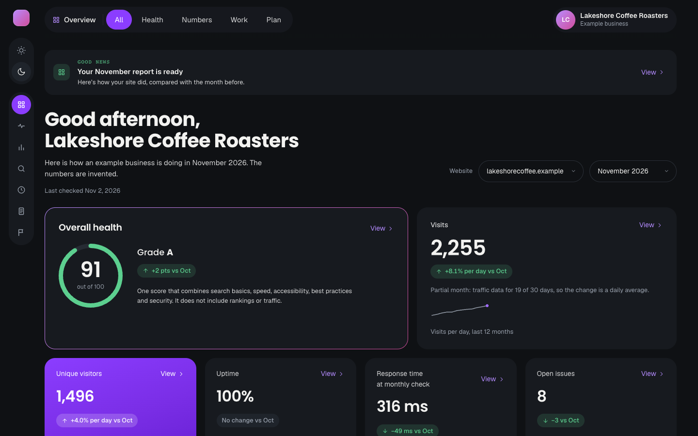
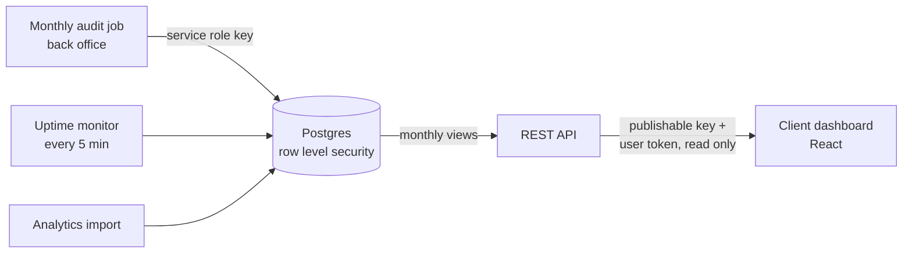

# Client Performance Dashboard

A monthly website report that small-business clients can actually read: one health score, the numbers that matter, a plain-English action plan, and a log of the work done for them.

I designed and built the production version of this for the clients of my web studio. This repository is a standalone rebuild for portfolio review. **It runs entirely on invented demo data** and does not connect to the production system.

**[Open the live demo](https://rnordmeyer.github.io/client-performance-dashboard/)**



## The problem

Small-business owners pay for website care but rarely see what it does. Typical SEO and analytics reports are long PDFs full of jargon that go unread, and the client is left asking, "Is my website OK?"

## What I built

- **One headline number.** An overall health score (0 to 100) with a letter grade, broken down into search, performance, accessibility, best practices and security.
- **Change, not just status.** Every metric says how it moved since last month, in words as well as color.
- **An action plan in plain English.** Each item says what to do, why it matters to the business, and what the audit found. Items are grouped into three outcomes clients care about: getting found, speed, and trust.
- **Proof of work.** A dated log of what the studio did that month.
- **Accessible by default.** Every chart has a "Show as a table" view, color is never the only signal, there is a skip link, light and dark themes, reduced-motion support, and contrast checked against WCAG 2.1 AA.

## Product decisions

| Decision | Why |
|---|---|
| Show **visits per day**, not visits per month | A month in progress was being compared with a full month, so traffic always looked like it was falling. Daily averages compare fairly. |
| **No lead or conversion data** on the dashboard | It invites the wrong conversation about attribution. The dashboard's job is site health and visibility. |
| **Read-only for clients** | Clients view reports; all writes come from the back-office audit job. Fewer moving parts and nothing for a client to break. |
| **Fail loudly** on data errors | An empty result must never render as a normal-looking report that says "no issues." |
| **Demo mode with fictional data** | Prospects can explore a full report before signing. The demo sends no data requests and holds no real client data. |

## Architecture



- **Front end:** React and TypeScript, built with Vite. No UI or chart libraries; charts and icons are hand-written SVG. Dark mode by default, with a light theme.
- **Data:** Postgres (Supabase). Daily rows roll up into monthly views. See [`db/schema.sql`](db/schema.sql).
- **Security:** Each login is a member of one client. Row level security policies check membership on every table and view, so the browser can only ever read its own client's rows. Staff accounts can see all clients. There are no write policies for browsers at all.
- **Data access:** Plain `fetch` calls to the REST API (no SDK). See [`src/data/source.ts`](src/data/source.ts).

## Run it

```bash
npm install
npm run dev
```

Open the local address it prints. It starts in demo mode; no account or configuration is needed.

## Project layout

```
src/
  App.tsx              page layout and month navigation
  components/          score ring, trend chart, plan, keyword table, work log
  data/demo.ts         invented demo data (deterministic, dated relative to today)
  data/source.ts       demo and live data sources
  data/types.ts        row types matching the database views
db/schema.sql          tables, row level security policies and monthly views
```

## What is not here

The production audit engine, its scoring method, and all client data stay private. The overall score in this demo is a simple average of the five categories.

---

© 2026 Ryan Nordmeyer. Shared for portfolio review.
